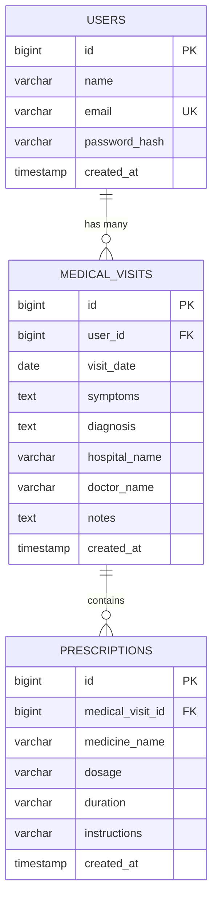

# 🩺 MediVault – Personal Medical History Tracker

**MediVault** is a modern, responsive full-stack healthcare web application designed for patients to securely store, organize, and reference their medical history—including hospital visits, illnesses, diagnoses, doctor details, and prescribed medications.

Built with **React.js + Vite**, **Spring Boot (Java 21)**, and **MySQL**.

---

## 🌟 Key Features

- **📊 Health Dashboard**:
  - Overview statistics: Total Hospital Visits, Prescriptions Recorded, Doctors Consulted, and Hospitals Visited.
  - Recent visits timeline with quick view links.
  - Direct call-to-action button to log new consultations.

- **➕ Add / Edit Medical Visit**:
  - Comprehensive clinical consultation logging: Visit Date, Hospital/Clinic Name, Doctor Name, Symptoms, Diagnosis, and Additional Notes.
  - **Dynamic Multi-Medicine Prescriptions**: Add, remove, and manage multiple medicines per visit with dosage, duration, and doctor instructions.

- **📑 Medical History Archive**:
  - Clean table layout with badge indicators.
  - **Full-Text Live Search**: Search by symptoms, diagnosis, medicine name, doctor, or hospital.
  - **Date Sorting**: Sort chronologically (Newest First / Oldest First).
  - Quick action buttons: View details, Edit record, and Delete with safe confirmation modal.

- **📄 Detailed Medical Report**:
  - Clean printable medical record summary card.
  - Clinical findings with separate symptoms and diagnosis callout cards.
  - Structured medications table with dosage and duration.
  - One-click print / export view.

- **🔐 Security & Patient Isolation**:
  - BCrypt password hashing and JWT (JSON Web Token) authentication.
  - **Strict User Record Isolation**: Users can only view, edit, search, and delete their own medical records.

---

## 🛠️ Technology Stack

| Layer | Technology | Details |
|---|---|---|
| **Frontend** | React.js (v18) + Vite | Fast build tool, responsive modern SPA |
| **Icons & Styling** | Lucide React + CSS3 | Medical blue & teal theme, custom responsive layouts |
| **Routing & HTTP** | React Router Dom + Axios | Client routing, JWT Bearer interceptor |
| **Backend** | Spring Boot (v3.3.4) + Java 21 | RESTful APIs, layered MVC architecture |
| **Security** | Spring Security 6 + JJWT | Stateless authentication, BCrypt hashing |
| **Database** | MySQL (8.0+) | InnoDB tables with foreign key constraints |
| **Persistence** | Spring Data JPA / Hibernate | Object-relational mapping, custom search queries |

---

## 📁 Project Architecture & Directory Structure

```
MediVault/
├── backend/                             # Spring Boot Java Application
│   ├── pom.xml                          # Maven dependencies
│   └── src/main/
│       ├── java/com/medivault/
│       │   ├── MediVaultApplication.java # Spring Boot main entry
│       │   ├── config/                  # SecurityConfig, CorsConfig, DataInitializer
│       │   ├── controller/              # REST Controllers (Auth, Visits, Dashboard)
│       │   ├── dto/                     # Request and Response transfer objects
│       │   ├── entity/                  # JPA Entities (User, MedicalVisit, Prescription)
│       │   ├── exception/               # GlobalExceptionHandler & custom exceptions
│       │   ├── repository/              # Spring Data JPA Repositories
│       │   ├── security/                # JWT Filter, Token Provider, UserDetailsService
│       │   └── service/                 # Business logic and patient isolation
│       └── resources/
│           └── application.properties   # Database and server configuration
│
├── frontend/                            # React + Vite Application
│   ├── package.json                     # Dependencies & scripts
│   ├── vite.config.js                   # Vite configuration & backend proxy
│   ├── index.html                       # HTML entry point with healthcare branding
│   └── src/
│       ├── api/                         # Axios client with JWT interceptor
│       ├── components/                  # Layout, Sidebar, Topbar, StatCard, Toast, Modal
│       ├── context/                     # AuthContext (state, login, logout, register)
│       ├── pages/                       # Login, Register, Dashboard, History, Form, Details
│       ├── App.jsx                      # Route definitions and auth route guards
│       ├── index.css                    # Healthcare color system & responsive styles
│       └── main.jsx                     # React root mount
│
├── database/
│   └── schema.sql                       # MySQL database DDL schema script
└── README.md                            # Comprehensive setup and usage guide
```

---

## 🗄️ Database Design

The database `medivault_db` comprises three relational tables:



---

## 🚀 Getting Started & Local Setup

### 1. Prerequisites
Ensure you have the following installed on your machine:
- **Java Development Kit (JDK 21 or newer)**: `java -version`
- **Apache Maven (3.9+)**: `mvn -version`
- **Node.js (v18+) & npm**: `node -v`
- **MySQL Server (8.0+)**: Running on port `3306`

---

### 2. Database Setup
1. Open your MySQL client or MySQL Workbench.
2. Run the SQL script located in `database/schema.sql`:
   ```sql
   source /path/to/MediVault/database/schema.sql;
   ```
   *(Or execute the script in MySQL Workbench or phpMyAdmin).*

3. Verify the database credentials in `backend/src/main/resources/application.properties`:
   ```properties
   spring.datasource.url=jdbc:mysql://localhost:3306/medivault_db?useSSL=false&allowPublicKeyRetrieval=true&serverTimezone=UTC
   spring.datasource.username=root
   spring.datasource.password=9884
   server.port=8081
   ```
   *(Update `spring.datasource.password` to match your local MySQL root password if different).*

---

### 3. Run the Backend (Spring Boot)
Open a terminal in the `backend/` folder:

```bash
cd backend
mvn clean compile
mvn spring-boot:run
```

- The Spring Boot backend will start on **`http://localhost:8081`**.
- On initial startup, the `DataInitializer` automatically seeds a demo user account and 3 sample medical visits.

---

### 4. Run the Frontend (React + Vite)
Open a separate terminal in the `frontend/` folder:

```bash
cd frontend
npm install
npm run dev
```

- The React application will start on **`http://localhost:5173`**.
- Open **`http://localhost:5173`** in your browser.

---

## 🔑 Demo Account Credentials

For quick testing and demonstrations, you can sign in directly using:

| Field | Value |
|---|---|
| **Email** | `demo.patient@medivault.com` |
| **Password** | `Password123` |

*(You can also click the **"Demo Fill"** button on the Login page, or register a new user anytime).*

---

## 📡 REST API Reference

All protected endpoints require the header:  
`Authorization: Bearer <your_jwt_token>`

### Authentication Endpoints (`/api/auth`)
| Method | Endpoint | Description | Public? |
|---|---|---|---|
| `POST` | `/api/auth/register` | Register a new user | Yes |
| `POST` | `/api/auth/login` | Authenticate and obtain JWT token | Yes |
| `GET` | `/api/auth/me` | Fetch authenticated user profile | No |

### Medical Visits Endpoints (`/api/visits`)
| Method | Endpoint | Query Params | Description |
|---|---|---|---|
| `GET` | `/api/visits` | `query`, `sort` (`asc` / `desc`) | Retrieve patient visits with search & sort |
| `GET` | `/api/visits/{id}` | - | Retrieve visit details by ID |
| `POST` | `/api/visits` | - | Create new visit with prescriptions |
| `PUT` | `/api/visits/{id}` | - | Update existing visit and prescriptions |
| `DELETE` | `/api/visits/{id}` | - | Delete visit and associated prescriptions |

### Dashboard Endpoints (`/api/dashboard`)
| Method | Endpoint | Description |
|---|---|---|
| `GET` | `/api/dashboard/stats` | Retrieve total visits, prescriptions, doctors, hospitals, and recent visits |

---

## 🛡️ Security & Patient Isolation Verification

MediVault enforces user-level data security:
- Password hashes are stored using **BCrypt** with automatic salt generation.
- All query operations filter by `user.id = :userId` derived from the validated JWT token.
- If a user tries to access or modify a record belonging to another user, the API returns `404 Not Found` / `401 Unauthorized`.

---

## 💡 Built for Academic & Portfolio Excellence
- **Clean Architecture**: Standard Controller-Service-Repository pattern.
- **Modern Healthcare UI**: Medical blue, teal, responsive cards, and clean typography.
- **Zero Mock Data**: Fully connected to MySQL database with permanent storage.
- **Beginner-Friendly**: Clear naming conventions, readable code, and no unnecessary bloat.
